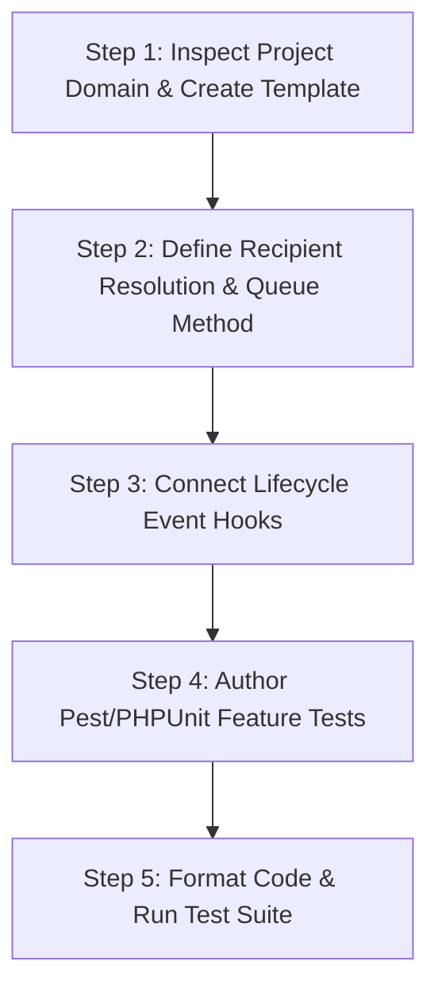

# Universal SMS Notification Protocol & Implementation Guidelines

> Standing guidelines for implementing, updating, and testing SMS notifications across Laravel applications and modular systems.

---

## 1. Project-Specific Adaptability

> [!NOTE]
> **Every project has its own unique domain, models, sender identity, and message requirements.** 
> While templates, headers, recipient entities, and lifecycles will differ per project (e.g., social pensions, health appointments, billing, logistics), the **core telco safeguards, architectural patterns, and step-by-step workflow** below remain universal.

---

## 2. Critical Telco & System Invariants (Universal Rules)

1. **Strict URL-Free Policy (Anti-Smishing & Carrier Filter Safety)**:
   - **NEVER** include `http://`, `https://`, or domain URLs in SMS template bodies unless the project explicitly uses a carrier-whitelisted dedicated alphanumeric shortcode.
   - Standard SIM-based modem gateways and Philippine telcos (Globe, Smart, DITO) automatically drop messages containing URLs.
   - Use clear, actionable portal guidance instead (e.g., `Check at online portal.` or `Login to your account.`).

2. **Single-Segment GSM 7-bit Character Budget (< 140 Chars)**:
   - Maximum capacity per single SMS segment is 160 GSM 7-bit characters.
   - Always craft base templates between **90–130 characters** to safely accommodate long dynamic values (names, dates, locations, reference numbers) without splitting into multiple billable segments.

3. **Non-Blocking Asynchronous Queueing**:
   - **NEVER** trigger synchronous SMS gateway HTTP calls directly within web controllers.
   - **ALWAYS** dispatch via asynchronous queues (`$smsService->queue(...)` or dedicated background jobs).
   - Prevents web UI freezing and request timeouts on slow gateway responses.

4. **Test Environment Isolation**:
   - Ensure `<env name="SMS_DRIVER" value="log"/>` is configured in `phpunit.xml` / `.env.testing` so test suites never make real gateway calls or fail on network timeouts.

---

## 3. Step-by-Step Implementation Workflow for AI

When implementing SMS notifications for **any** project, execute these 5 steps:



### Step 1: Discover & Author Domain-Specific Templates
- Check the project's existing template class (e.g. `SmsTemplates.php` or notification classes).
- Use dynamic sender header prefix: `config('sms.sender_name', 'YourApp')`.
- Write concise, 100% URL-free template methods with dynamic arguments.
- Example pattern:
  ```php
  public static function eventRescheduled(string $title, string $date, ?string $venue = null): string
  {
      $header = self::header();
      $venueText = $venue ? " at {$venue}" : '';
      return "{$header} Rescheduled Notice: {$title} moved to {$date}{$venueText}. Please be guided.";
  }
  ```

### Step 2: Implement Recipient Resolution & Asynchronous Queueing
- Map project-specific recipient models (e.g. `User`, `Customer`, `SeniorCitizen`, `Member`) to extract:
  - Destination mobile number (normalized via `PhoneNumberFormatter`).
  - Polymorphic foreign keys (`user_id`, model ID).
- Create or use audience queueing helpers when broadcasting to groups or filtered segments.

### Step 3: Wire Application Lifecycle Event Hooks
- Connect SMS queueing to the relevant business lifecycle in controllers, observers, or event listeners:
  - **Entity Created / Scheduled** $\rightarrow$ Queue initial notice.
  - **Entity Updated / Rescheduled** (date, time, venue, or status changed) $\rightarrow$ Queue update notice.
  - **Entity Cancelled / Deleted** $\rightarrow$ Queue cancellation notice.

### Step 4: Write Feature & Unit Tests
- Add unit assertions for the new SMS template strings.
- Add feature tests asserting notification records are queued in the database on create, update, and cancel actions:
  ```php
  $notification = Notification::where('type', 'event_rescheduled')->first();
  expect($notification)->not->toBeNull();
  expect($notification->message)->toContain('Rescheduled Notice:');
  ```

### Step 5: Format and Verify
- Run code formatting: `vendor/bin/pint --format agent`
- Run test suite: `php artisan test --compact`

